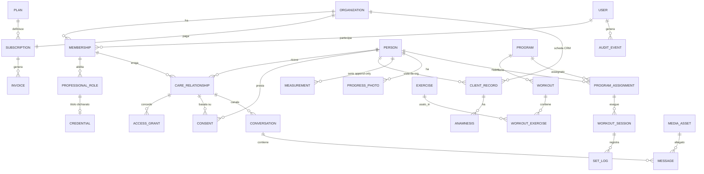

# Modello dati (ER logico)

Convenzioni: PK `id` UUID; ogni tabella di dominio ha `organization_id` salvo `Person` e tabelle globali; `created_at`, `updated_at`; tabelle sensibili append-only dove indicato. Un modulo non legge le tabelle di un altro: i riferimenti tra moduli sono ID senza FK fisica cross-modulo (FK solo dentro lo schema del modulo).

## Entità principali

### Identity & Organizzazioni
- **Organization**(id, nome, tipo `individuale|studio`, p_iva, sede_fiscale, stato) — tenant. Un PT singolo = org `individuale` con 1 membership.
- **User**(id, email, mfa, stato) — credenziali di accesso. Un User può avere più Membership (anche in org diverse).
- **Membership**(id, organization_id, user_id, stato, inizio, fine, `is_owner`).
- **ProfessionalRole**(id, membership_id, `role_code` ∈ coach|nutrizionista|fisioterapista|medico|…, stato). `role_code` da tabella `RoleDefinition` (regolamentato sì/no, domini accessibili di default, richiede credential sì/no) → nuovi ruoli senza modifiche di codice.
- **Credential**(id, professional_role_id, tipo, ente/albo, numero, dichiarato_il, `verifica_stato`, verificato_da, verificato_il) — autodichiarazione + verifica a campione (ADR-0008).
- **Permission/Policy**: policy dichiarative per ambito, non tabelle per-utente; `RoleDefinition` mappa ruolo→capacità.

### Persone e relazioni di cura
- **Person**(id, nome, cognome, data_nascita, contatti, user_id nullable) — identità **globale**, non appartiene a un tenant.
- **ClientRecord**(id, organization_id, person_id, note_crm, tag, origine) — vista CRM *dell'organizzazione*; un cliente con due org ha due ClientRecord distinti. Nessun dato clinico qui.
- **CareRelationship**(id, person_id, membership_id, role_code, stato `invitata|attiva|sospesa|chiusa`, inizio, fine, invitata_da) — sostituisce `cliente.personal_trainer_id`.
- **AccessGrant**(id, care_relationship_id, dominio ∈ allenamento|misure|dieta|foto|salute|chat, livello `none|summary|full`, consent_id, inizio, fine) — il livello effettivo è `min(grant, consenso valido, ruolo)`.
- **Consent**(id, person_id, care_relationship_id nullable, ambito, versione_testo, base_giuridica, prestato_il, revocato_il, prova) — foto e dati sanitari: ambiti separati con consenso esplicito (Art. 9).

### Training
- **Exercise**(id, organization_id nullable [null = catalogo globale], nome, gruppi_muscolari, media_asset_id).
- **Program**(id, organization_id, autore_membership_id, nome, obiettivo, versione) → **Workout** → **WorkoutExercise**(serie, rip, carico_target, recupero, note). I programmi pubblicati sono immutabili: modifica = nuova versione.
- **ProgramAssignment**(id, program_id, person_id, care_relationship_id, inizio, fine, stato).
- **WorkoutSession**(id, assignment_id, workout_id, iniziata_il, completata_il, `client_uuid` unico) e **SetLog**(id, session_id, exercise_id, n_serie, reps, carico, rpe, `client_uuid` unico) — idempotenti per sync offline.

### Misure e foto
- **Measurement**(id, person_id, tipo, valore, unità, misurata_il, `fonte` ∈ manuale|plicometro|bioimpedenza|wearable…, `strumento_metodo`, autore_membership_id|null, autore_person_id|null, `rettifica_di` nullable) — **append-only**: la correzione è una nuova riga che punta a `rettifica_di`. Serie per `(person_id, tipo, fonte)`.
- **ProgressPhoto**(id, person_id, media_asset_id, scattata_il, consent_id).

### Messaggistica e media
- **Conversation**(id, care_relationship_id, stato), **Message**(id, conversation_id, mittente, testo, media_asset_id, inviato_il, letto_il). Conversazione legata alla relazione: la chiusura/revoca ne limita l'accesso.
- **MediaAsset**(id, owner_organization_id | person_id, tipo, storage_key `org/{id}/person/{id}/…`, mime, dimensione, `scan_stato`, provider_video_id) — mai blob in DB.

### Licenze & Billing
- **Plan**(id, nome, canone_per_posto, posti_inclusi, soglia_clienti_attivi, valuta=EUR, attivo).
- **Subscription**(id, organization_id, plan_id, posti, stato, periodo, stripe_subscription_id). Limite posti verificato su `Membership` attive; soglia clienti su `CareRelationship` attive (metric "cliente attivo" da definire, vedi domande residue).
- **Invoice**(id, subscription_id, numero, importo, iva, stato, sdi_stato, pdf_media_id).

### Trasversali
- **AuditEvent**(id, ts, actor_user_id, impersonator_user_id nullable, organization_id, person_id, azione, risorsa, esito, ip) — append-only, immutabile (tabella senza UPDATE/DELETE per il ruolo applicativo, hash chain opzionale).
- **OutboxEvent**(id, aggregate, tipo, payload, creato_il, pubblicato_il).
- **ImpersonationSession**(id, operatore, organization_id, motivo, ticket, inizio, scadenza, fine).

## Isolamento e accesso ai dati
- RLS PostgreSQL su `organization_id` (variabile di sessione `app.org_id`); le tabelle su `Person` (Measurement, Consent, ProgressPhoto…) usano policy basata su `AccessGrant` attivo, calcolata da una funzione/vista che il modulo Consensi espone.
- Il filtro applicativo duplica la RLS (difesa in profondità); test di isolamento tra tenant e di grant cross-organizzazione in CI.
- Cifratura a livello di campo: `Anamnesis`, `Measurement` (tipi sanitari), note cliniche, `Consent.prova`; chiavi per organizzazione (envelope encryption).

## Fuori MVP (previsto nel modello ma non implementato)
`NutritionPlan/Meal/FoodDiary`, `Appointment`, `CheckIn`, `ClientPayment`, `WearableSample`.
